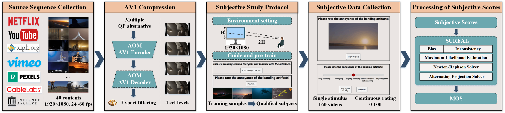
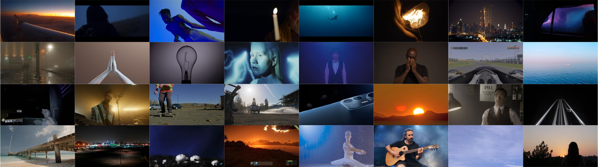
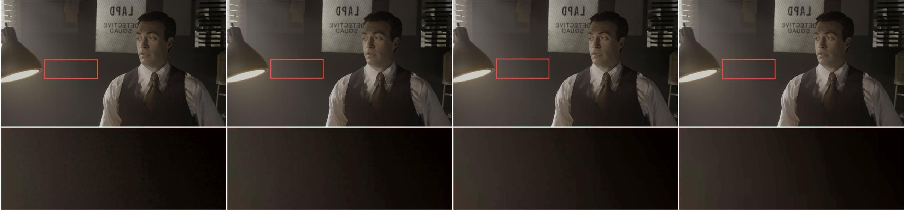
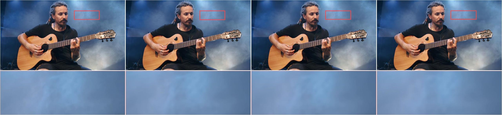
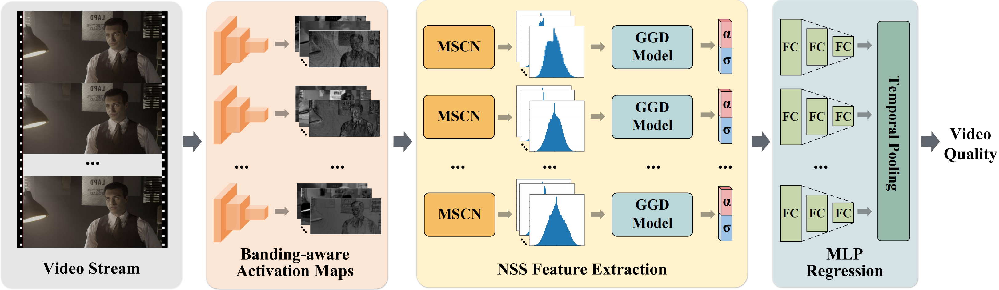
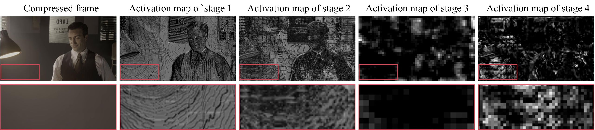

<div align="center">

<div>
<a href="https://github.com/uniqzheng/CBAND"></a>
    <a href="https://github.com/uniqzheng/CBAND"></a>
    <a href="https://ieeexplore.ieee.org/document/11104966"></a>
    <a href="https://github.com/uniqzheng/CBAND"></a>
    <a href="https://github.com/uniqzheng/CBAND"></a>
     <a href="https://github.com/uniqzheng/CBAND"></a>
</div>

<h1>Subjective and Objective Quality Assessment of Banding Artifacts on Compressed Videos</h1>

</div>

## Dataset -- LIVE-YT-Banding


<div style="width: 80%; text-align:center; margin:auto;">
</div>

We have created a first-of-a-kind open banding VQA dataset, dubbed LIVE-YT-Banding. Please find the dataset in [link](https://drive.google.com/drive/u/0/folders/1WBbD9QWfKuirTZGNlZIxAe7X1RmWlzJw).

<div style="width: 80%; text-align:center; margin:auto;">
</div>

<div style="width: 80%; text-align:center; margin:auto;">
</div>
<div style="width: 80%; text-align:center; margin:auto;">
</div>
<div style="width: 80%; text-align:center; margin:auto;">
</div>

# Model -- CBAND
We develop an effective and efficient new no-reference (NR) video quality evaluator, dubbed CBAND. CBAND leverages the properties of the learned statistics of natural images expressed in the embeddings of deep neural networks.

<div style="width: 80%; text-align:center; margin:auto;">
</div>

<div style="width: 80%; text-align:center; margin:auto;">
</div>

## 1. Feature Extraction
```shell
python /src/MSCNfeature.py
```

## 2. Training
```shell
bash /src/train_split.sh
```

## 3. Performance Evaluation
```shell
python /src/process_metric_score.py
```

## Citation
```
@ARTICLE{11104966,
  author={Zheng, Qi and Chen, Li-Heng and He, Chenlong and Birkbeck, Neil and Wang, Yilin and Adsumilli, Balu and Bovik, Alan C. and Fan, Yibo and Tu, Zhengzhong},
  journal={IEEE Transactions on Image Processing}, 
  title={Subjective and Objective Quality Assessment of Banding Artifacts on Compressed Videos}, 
  year={2025},
  volume={34},
  number={},
  pages={4983-4998},
  keywords={Videos;Databases;Quality assessment;Image coding;Video compression;Quantization (signal);Load modeling;Distortion;Computational modeling;Transcoding;Banding artifact;subjective video quality;objective video quality;video compression;compression artifact},
  doi={10.1109/TIP.2025.3592543}}

@article{Zheng_2025,
   title={Subjective and Objective Quality Assessment of Banding Artifacts on Compressed Videos},
   volume={34},
   ISSN={1941-0042},
   url={http://dx.doi.org/10.1109/TIP.2025.3592543},
   DOI={10.1109/tip.2025.3592543},
   journal={IEEE Transactions on Image Processing},
   publisher={Institute of Electrical and Electronics Engineers (IEEE)},
   author={Zheng, Qi and Chen, Li-Heng and He, Chenlong and Birkbeck, Neil and Wang, Yilin and Adsumilli, Balu and Bovik, Alan C. and Fan, Yibo and Tu, Zhengzhong},
   year={2025},
   pages={4983–4998} }
```